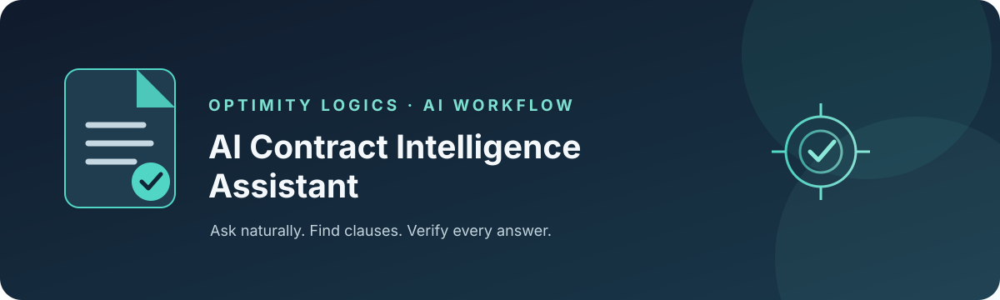

<p align="center">
  
</p>

<h1 align="center">AI Contract Intelligence Assistant</h1>

<p align="center">Ask contract questions in plain English and receive source-grounded answers with clause-level evidence.</p>

<p align="center"><strong>n8n · Google Gemini · Retrieval-Augmented Generation (RAG)</strong></p>

---

## 1. Overview

The AI Contract Intelligence Assistant helps legal, procurement, finance, and operations teams find relevant information in contract PDFs without manually searching through every document. Users can ask a question in natural language and receive a concise answer supported by retrieved contract text and a source reference.

The workflow uses retrieval-augmented generation (RAG): contract text is extracted, split into smaller passages, embedded for semantic search, and retrieved when a question is asked. The agent is instructed to answer from retrieved contract clauses rather than fill gaps with general knowledge.

> **Important:** This is a document-review aid, not a substitute for legal advice. A qualified reviewer should verify the original agreement before making legal or commercial decisions.

## 2. Features

- **PDF ingestion:** Upload a text-based contract PDF through the n8n form.
- **Semantic search:** Retrieve passages by meaning using Google Gemini embeddings and an in-memory vector store.
- **Natural-language Q&A:** Ask about payment terms, renewal, termination, liability, confidentiality, governing law, and other clauses.
- **Source-grounded answers:** Return an answer with a short evidence quote and source information.
- **Abstention behavior:** Instruct the agent to say when information is not stated or a named contract cannot be found.
- **Retrieval diagnostics:** Run a separate retrieval-check path to inspect search results independently from answer generation.
- **Conversation context:** Use short-window memory for recent follow-up questions.

## 3. Example questions

- What payment terms are stated in the Vertex Logistics Transport Agreement?
- What notice period does the Orbit Cloud Services Agreement specify for termination?
- Does the Premier Facility Services Agreement describe an automatic renewal?
- Which clause discusses confidentiality in the Zenith Software Licence and Support Agreement?
- Is a liability cap stated in this agreement?

These are example prompts only. Answers depend on the contract PDFs actually loaded into the workflow.

## 4. How it works

### Contract ingestion

1. Open the **Upload contract** form and submit one text-based PDF.
2. The PDF loader extracts text and attaches the source filename as metadata.
3. The recursive character text splitter divides the text into overlapping chunks.
4. Google Gemini embeddings convert the chunks into vectors.
5. The **Contract Vector Store** stores the chunks for semantic retrieval.

Upload each contract once in a fresh library. Repeated uploads can create duplicate passages.

### Question answering

1. Submit a question through the n8n chat trigger.
2. The **Contract RAG Agent** receives the question and uses the configured Gemini chat model.
3. The `contract_search` tool retrieves relevant passages from the contract library.
4. The agent produces an answer grounded in retrieved text, with evidence and a source.
5. A reviewer checks the cited clause in the original PDF before acting on the result.

### Retrieval diagnostics

The separate **Retrieval check** path queries the vector store without generating a final AI response. Use it to determine whether a problem is caused by search not returning the relevant passage or by the agent not using retrieved evidence correctly.

## 5. Answer format

The assistant is instructed to use a consistent, auditable structure:

- **Answer:** A direct response that preserves dates, amounts, and periods as written.
- **Evidence:** A short quotation containing the key wording from the contract.
- **Source:** Contract name, clause number/title when available, and source document filename.

If information cannot be found, the assistant should say it is not stated in the relevant contract rather than guess. If a named agreement is not in the library, it should state that the contract could not be found.

## 6. Technology stack

| Component | Purpose |
|---|---|
| n8n | Workflow orchestration, PDF upload form, chat interface, and AI connections |
| Google Gemini chat model | Generates concise responses grounded in retrieved passages |
| Google Gemini embeddings | Embeds document chunks and user queries for semantic search |
| In-memory vector store | Stores and retrieves contract text chunks for the demo |
| PDF data loader | Extracts text and attaches source metadata |
| Recursive character text splitter | Divides extracted text into overlapping chunks |
| Simple Memory | Retains a limited window of recent chat context |

## 7. Repository structure

```text
.
├── README.md
├── workflow.json
├── assets/
│   └── banner.svg
└── docs/
    └── architecture.md
```

- `workflow.json` — sanitized n8n workflow export.
- `docs/architecture.md` — architecture, data flow, and implementation checks.
- `assets/banner.svg` — repository banner.

## 8. Requirements

- An n8n instance with compatible LangChain/n8n AI nodes available.
- Your own Google Gemini API credential configured in n8n for chat and embeddings.
- Text-based contract PDFs that you are authorized to process.
- Approval to process the documents under your organization's data-handling policies.

Node availability, model identifiers, and credential setup can vary by n8n version. Review the imported workflow and select supported models in your environment before running it.

## 9. Setup and run

1. **Review the export.** Inspect `workflow.json` before importing it.
2. **Import into n8n.** Use n8n's workflow import feature.
3. **Configure credentials.** Reconnect your own Google Gemini credential to the chat and embedding nodes. Credentials are intentionally not included.
4. **Verify model settings.** Confirm the selected Gemini models are available to your account and supported by your n8n version.
5. **Check vector-store settings.** Ensure ingestion and retrieval use the same store key and compatible embedding configuration.
6. **Upload contracts.** Use the form to upload one PDF at a time. Avoid duplicate uploads.
7. **Test retrieval.** Run the retrieval-check path and confirm expected passages appear.
8. **Ask a test question.** Compare the answer, evidence, and source with the original PDF before relying on the result.

The workflow export is a demonstration template, not a production deployment. Inspect all nodes and connections after import. The workflow is not activated by default in this repository export.

## 10. Testing checklist

- [ ] Ask about a clause that clearly exists in a contract.
- [ ] Ask about a term that is absent from a contract.
- [ ] Name a contract that is not in the library.
- [ ] Distinguish renewal, non-renewal notice, termination for convenience, and termination for cause.
- [ ] Verify dates, amounts, and notice periods against the original text.
- [ ] Ask about multiple agreements and check that terms are not mixed between contracts.
- [ ] Inspect retrieval-check results for a known clause.
- [ ] Check duplicate upload behavior and re-ingestion after an n8n restart.

## 11. Security and responsible use

- Do not upload confidential, personal, privileged, or commercially sensitive contracts unless your organization has approved the processing environment and provider configuration.
- Configure authentication and access controls before making the chat or upload form available to other users.
- The in-memory store is not a multi-user security boundary. Users with access to the workflow may be able to query the loaded library.
- Verify every material answer against the original contract. Do not treat generated responses as legal advice or proof that a clause is enforceable.
- Never commit API keys, credentials, real customer contracts, or confidential sample documents.
- For production, add authentication, role-based access, document-level permissions, persistent storage, audit logging, monitoring, backups, retention policies, and an evaluation test set.

## 12. Limitations and production improvements

**Known limitations**
- **In-memory storage:** Data may be lost when the n8n runtime restarts.
- **Text-based PDFs:** Scanned PDFs may require OCR before ingestion.
- **Chunk boundaries:** Character-based splitting may divide a clause across chunks.
- **Retrieval coverage:** Semantic top-k retrieval can miss relevant clauses, especially for broad or multi-part questions.
- **No document authorization model:** Production deployments need access controls and document-level permissions.
- **Sample-specific prompt:** Update the agent instructions to match the contracts actually loaded.
- **No legal conclusions:** The assistant reports retrieved text; it does not determine whether terms are fair, valid, or enforceable.

**Recommended improvements**
1. Replace the in-memory store with a persistent vector database.
2. Split by clause or heading where feasible, preserving clause identifiers as metadata.
3. Add duplicate detection and document-version tracking.
4. Add role-based permissions and document-level access filters.
5. Log queries, retrieved sources, outputs, and reviewer feedback with appropriate privacy controls.
6. Add OCR support for scanned documents.
7. Create regression tests for retrieval quality, source attribution, and unsupported-answer behavior.

## About

Built by [Optimity Logics](https://optimitylogics.com/) 

---

**Disclaimer:** This project is provided for demonstration and educational purposes. Review the workflow, privacy requirements, model configuration, and output quality before using it with real contracts.
